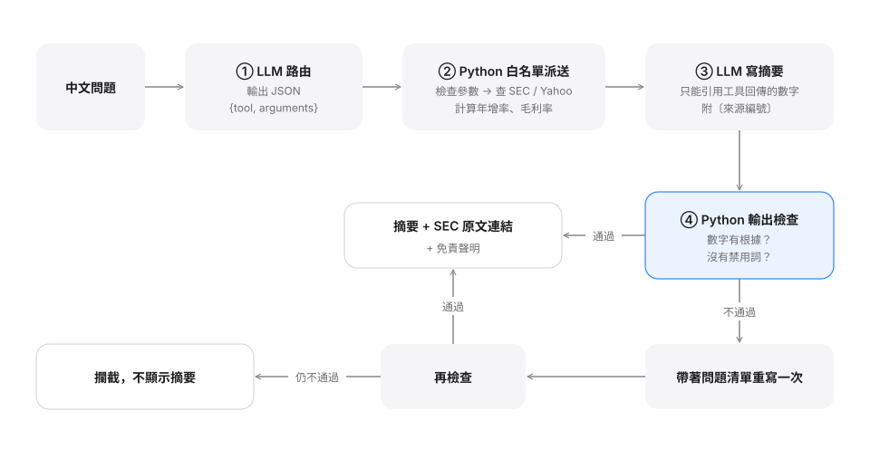

# 📊 複委託財報小幫手｜Tool Use Agent

[](https://colab.research.google.com/github/ck-x-x/financial-report-agent/blob/main/financial_report_agent.ipynb)

用中文問「輝達最新一季財報怎麼樣？」，程式自動查 **SEC EDGAR** 官方財報和 **Yahoo Finance** 市場預估，再整理成**附出處的繁體中文摘要**。

> ⚠️ 本專案只整理已公開的財報資訊，**不構成任何投資建議**。

---

## 為什麼做這個

透過複委託買美股時，英文財報很花時間讀；直接問聊天機器人，又常拿到來源不明、甚至算錯的數字。

所以這個工具的設計原則是：

> **數字一律由程式從官方資料算出來，AI 只負責「選工具」和「把結果講成中文」，而且講出來的每個數字都要經過程式查核。**

## 四階段流程

<p align="center"></p>

| 階段 | 誰負責 | 做什麼 |
|---|---|---|
| ① 路由 | LLM | 把問題轉成 `{"tool": ..., "arguments": ...}`，此時還沒看到任何財報數字 |
| ② 派送執行 | Python | 白名單檢查工具名稱與參數型別（不用 `eval`），執行對應函式 |
| ③ 寫摘要 | LLM | 只能照抄 Python 算好的數字，每個數字標〔來源〕 |
| ④ 輸出檢查 | Python | 摘要裡每個數字都要在工具結果中找得到；出現「買進」「目標價」等禁用詞就打回重寫 |

## 設計重點

| 面向 | 做法 |
|---|---|
| **LLM 供應商** | Groq（`openai/gpt-oss-120b`）為主；Groq 失敗時**自動切換 Google Gemini**，每次呼叫都記錄由哪一家完成 |
| **資料來源** | SEC EDGAR XBRL API（官方 GAAP 數字）、Yahoo Finance（市場預估 EPS） |
| **工具** | `get_watchlist`、`get_earnings_summary`、`get_eps_surprise_history`、`clarify` |
| **財報邏輯** | 依起訖日期判斷單季／全年；Q4 用「全年 − 前三季」推算並標記為推算值；不信任 SEC 的 `fy/fp` 標籤，改用實際日期配對 |
| **可信度** | 白名單派送、輸出數字查核、禁用詞檢查、不過關重寫一次後再攔截 |
| **安全** | API key 只從 Colab 密鑰／環境變數讀取，錯誤訊息會遮蔽金鑰 |
| **測試** | 離線單元測試（Q4 推算、年增率、驚喜率、派送器拒絕、輸出檢查、備援切換）＋ 真實資料測試 ＋ 路由批次測試 |

## 範例輸出

問：「輝達最新一季財報怎麼樣？」（實際執行結果節錄）

```text
LLM 呼叫紀錄：
1. 第一階段 路由：Groq（groq:openai/gpt-oss-120b，0.8 秒）
2. 第三階段 寫摘要：Groq（groq:openai/gpt-oss-120b，2.0 秒）

輝達 NVDA FY2027 Q2 2026-04-27 ~ 2026-07-26

1. 營收 962.21 億美元，較去年同期 467.43 億美元成長 105.9%〔1〕。
2. 淨利 596.88 億美元，較去年同期增長 125.9%〔1〕。
3. GAAP 每股盈餘 (EPS) 為 2.46 美元，去年同期為 1.08 美元〔1〕。
4. 毛利率 75.0%，較去年同期 72.4% 提升 2.6 個百分點〔1〕。

資料來源：
〔1〕 0001045810-26-000075（SEC EDGAR 原始申報連結）
```

Gradio 介面會把每個階段攤開：AI 原始 JSON → Python 解析後的請求 → 工具實際回傳 → 每一版草稿與檢查結果 → 最終摘要。

<!-- 建議在這裡放一張 Gradio 介面截圖：把圖片放到 docs/ 資料夾後取消下一行的註解 -->
<!--  -->

## 專案結構

```
financial-report-agent/
├── financial_report_agent.ipynb   # 完整教學版 notebook（逐步建構＋測試）
├── app/                           # 本機執行版
│   ├── app.py                     # 由 notebook 整理出的可執行版本
│   └── requirements.txt
├── LICENSE
└── README.md
```

## 怎麼執行

### 方法一：Google Colab（最簡單）

1. 點上方「Open in Colab」。
2. 左側 🔑「密鑰」新增：
   - `Groq`：到 [console.groq.com/keys](https://console.groq.com/keys) 申請（必要）
   - `Gemini`：到 [aistudio.google.com/apikey](https://aistudio.google.com/apikey) 申請（選用，沒有就不啟用備援）
3. 從上往下執行。第 3 節會請你輸入姓名與 email，這是 SEC EDGAR 規定的 User-Agent，只在執行期間使用、不會存檔。

### 方法二：在自己電腦執行（Gradio 介面）

```bash
cd app
pip install gradio==6.30.0 -r requirements.txt
export GROQ_API_KEY="你的 Groq key"
export SEC_USER_AGENT="你的名字 your@email.com"
export GEMINI_API_KEY="你的 Gemini key"   # 選用
python app.py
```

## 已知限制

- 只支援固定清單中的 7 家美股（NVDA、AAPL、MSFT、GOOGL、AMZN、META、TSLA）；台積電 ADR 用 20-F／6-K 申報，沒有季度 XBRL 資料。
- Yahoo Finance 會對 Colab、Hugging Face 這類雲端 IP 限速，查不到時會在摘要中誠實說明，不會中斷。
- Yahoo 的 EPS 多為調整後（non-GAAP）口徑，與 SEC 的 GAAP EPS 分開呈現，不直接比較。
- 一次只處理一家公司、只看「最新一季」與「最近 N 季 EPS 驚喜率」。

## 使用技術

Python · Groq（aisuite）· Google Gemini（google-genai）· SEC EDGAR XBRL API · yfinance · pandas · Gradio

## 授權

MIT License，見 [LICENSE](LICENSE)。
